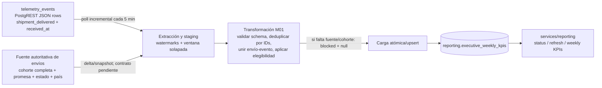

# Executive Reporting Pipeline — Design

**Status:** Design proposal. KPI and destination contract: [`company-BRIEFING.md`](./company-BRIEFING.md).

**Reporting cadence:** TrackFlow's consolidated report is scheduled weekly on Monday at 07:00 `America/Los_Angeles` for the previous fully completed ISO week (UTC boundaries), consistent with the company briefing. The timezone/schedule is a project assumption and requires owner confirmation before production scheduling. Run manually from the repository root with `python data/pipelines/pipeline.py`; optionally pass `--week-start YYYY-MM-DD` (a Monday) and `--trigger-type manual|scheduled|retry|backfill`.

## 1. Goal and boundaries

Produce a governed weekly executive report for TrackFlow, with an extensible refresh path for dashboards. The pipeline combines authoritative operational source data with mandatory telemetry signals where relevant, validates coverage, computes reproducible KPI aggregates, and writes only to PostgreSQL `reporting.executive_weekly_kpis`.

The report is separate from the technical telemetry report at `GET /telemetry/report`. That endpoint remains focused on technical event metrics. This pipeline does not write to `telemetry_events` and does not treat telemetry events as complete business ledgers when the KPI contract requires a full source universe.

## Estado Actual

### Telemetría disponible y almacenamiento

El backoffice actual emite telemetría cuando hay una acción o medición real: `api_latency_recorded` por respuestas HTTP, `frontend_error_recorded` por errores o lentitud del frontend, `web_vital_recorded` para Web Vitals, `section_viewed` al navegar y `feature_used` para interacciones instrumentadas. El catálogo también define eventos operativos/de negocio, pero su presencia en `docs/telemetry/event-schemas.json` no demuestra que exista un productor activo ni una fuente autoritativa completa. En particular, el plan de telemetría indica que los payloads de varios eventos de negocio aún no pueden completarse con las fuentes actuales. Los hooks de autenticación (`login_failed`, `login_succeeded` y expiración de sesión) están previstos, pero no hay proveedor/formulario de autenticación real conectado; el reporte puede devolver la métrica de fallos vacía si no hay eventos reales. No se deben simular.

El flujo implementado es `POST /telemetry/events` → validación del sobre, tipo, propiedades permitidas y ventana temporal → inserción de registros válidos en `telemetry_events`. La ruta activa configura la persistencia mediante Supabase REST (`supabase_telemetry_url`, por defecto el recurso `/rest/v1/telemetry_events`). El repositorio también contiene un modelo SQLAlchemy y una migración para una tabla `telemetry_events`; eso no cambia que la ruta actual de ingesta y el reporte lean/escriban mediante Supabase REST. No se afirma aquí que el recuento histórico sea el recuento actual del almacén.

### Qué responde el reporte técnico

`GET /telemetry/report` responde preguntas de ingeniería sobre el volumen diario de eventos recibidos, la proporción de eventos técnicos de error por tipo (su denominador son todos los eventos capturados del período, no todas las peticiones HTTP) y la tasa diaria de fallos de login sobre intentos, cuando existen esos eventos. Acepta un rango explícito, usa siete días por defecto, limita el rango a 31 días y cachea la respuesta durante 60 segundos. Es útil para observar actividad instrumentada, errores del frontend y señales disponibles de autenticación; no es un reporte de resultados operativos de negocio.

Como referencia histórica y no como estado actual garantizado, una respuesta observada el 2026-11-05 contenía 25 eventos para ese día, un `frontend_error_recorded` (4% de los eventos) y una serie de fallos de autenticación vacía. Las pruebas automatizadas usan datos simulados y no deben confundirse con datos persistidos.

### Brecha de negocio que requiere el pipeline

El reporte técnico no puede responder: **¿qué porcentaje de los envíos elegibles de cada país se entregó en o antes de la fecha prometida, y se alcanzó el objetivo de más del 97% (M01)?** Contar `shipment_delivered` no basta: faltan el universo/cohorte completa de envíos elegibles (incluidos los aún pendientes y los tardíos), la promesa autoritativa, las reglas de exclusión y maduración y la dimensión de país fiable. Por tanto, no se puede construir ni el numerador ni, sobre todo, el denominador correcto solo a partir del reporte técnico o del catálogo de eventos. El plan de telemetría marca M01 como incompleto hasta integrar la fuente autoritativa de envíos.

El pipeline dedicado debe integrar esa fuente operacional, validar cobertura y calcular M01 a su grano definido; debe hacer lo mismo para los demás KPIs del briefing cuando estén disponibles sus fuentes y contratos. Los resultados ejecutivos pertenecen a `reporting.executive_weekly_kpis`, separados de los eventos crudos y métricas técnicas en `telemetry_events`.

## Fase 2 — Diseño concreto del pipeline (primer KPI: M01)

### Propósito en una frase
Producir cada semana el consolidado de entregas a tiempo que alimenta el informe de la CEO Thomas Harry, calculando M01 (envíos elegibles entregados en o antes de la promesa / todos los envíos elegibles de la cohorte × 100) con la métrica obligatoria M01 de telemetría —`shipment_delivered`— como señal de entrega, y con la fuente autoritativa de envíos como denominador y fuente de promesa/país.

`shipment_delivered` aporta evidencia del numerador, pero no basta por sí solo para calcular M01: se debe unir a la cohorte completa de envíos elegibles, incluidos pendientes y tardíos. En el repositorio actual no se encontró una tabla autoritativa de envíos ni el contrato de promesa; por ello M01 debe publicarse como `blocked` y `metric_value: null` hasta integrar esa fuente. No usar fixtures ni el conteo de eventos como proxy de resultado de negocio.

### Extracción: formato y frecuencia

- **Telemetría:** los eventos llegan primero a `POST /telemetry/events` como envelope JSON. El backend valida el esquema/allowlist y los envía como filas JSON mediante Supabase REST (PostgREST) a `telemetry_events`. Los campos persistidos incluyen `event_id` (clave primaria estable), `timestamp` (ocurrencia UTC), `received_at` (ingesta UTC), `event_type`, `schema_version`, `properties` y `tags`. El productor persiste eventos al ocurrir; el pipeline los leerá incrementalmente cada 5 minutos usando `received_at` como cursor de ingesta y una ventana de solapamiento para capturar llegadas tardías. La cadencia de cinco minutos es propuesta de diseño, no está desplegada.
- **Fuente de dominio requerida para M01:** extraer un snapshot/delta de envíos con `shipment_id` estable, cohorte/fecha de creación, país de destino, fecha prometida, estado y fecha real de entrega, además de elegibilidad/exclusiones. El formato recomendado es filas relacionales tipadas vía conector SQL/API, no inferir estas columnas de `properties`. El sistema dueño, contrato, conector y cadencia aún deben acordarse; hasta entonces M01 queda bloqueado.
- **Publicación:** recalcular semanas afectadas cada 5 minutos cuando haya deltas de fuente y ejecutar la publicación semanal consolidada el lunes a las 07:00 `America/Los_Angeles` según el BRIEFING. La semana reportada es la ISO UTC completa anterior. Confirmar zona horaria y calendario con la dueña del negocio antes de programar producción.

### Flujo de datos



### Actualizaciones de registros y deduplicación

`telemetry_events` es un ledger append-only en el contrato actual: cada evento se identifica por `event_id` y su clave primaria impide insertar dos veces el mismo evento en el destino fuente; el pipeline también deduplica por `event_id` al combinar lotes solapados. No tratar un nuevo evento del mismo envío como si reemplazara automáticamente un evento previo: conservar la señal y resolver el estado de negocio mediante el registro vigente del envío.

La fuente de envíos puede corregir/actualizar registros existentes. Leer por `updated_at` (o cursor equivalente que confirme el dueño), hacer upsert del staging por `shipment_id` y volver a calcular las semanas afectadas. En la tabla agregada usar la clave lógica `(week_start, week_end, metric_code, dimensions, definition_version)` y upsert transaccional, protegido contra ejecuciones concurrentes por semana. Los eventos tardíos/correcciones vuelven a procesar la cohorte y reemplazan el agregado lógico, no crean una fila KPI duplicada. Conservar `run_id`, `source_watermark` y `calculated_at` para trazabilidad; no sobreescribir semánticas de versión.

### Fase 3 — Resiliencia, idempotencia y auditoría de corridas

**Implemented behavior:** `load_weekly_kpis_task` serializes writers with a PostgreSQL transaction-scoped advisory lock for the M01 week, replaces that complete week's M01/definition 1.0 rows and reinserts the validated snapshot in the same transaction. The insert retains `ON CONFLICT` against the briefing's unique `(week_start, week_end, metric_code, dimensions, definition_version)` key; this also permits dimensions removed by a corrected source snapshot to disappear without exposing a partial publication. No schema is created at runtime. The flow writes `data/pipelines/logs/pipeline-runs.jsonl` with mode-restricted local permissions, one `running` record and one terminal record per invocation; records include start/end timestamps, processed source row count, written aggregate count, status and redacted error metadata. Generated logs are git-ignored. This local JSONL audit is suitable for development; production deployments should move it to the approved durable operational store.

#### Idempotencia ante fallas durante la carga

La carga se implementará como publicación transaccional por semana y definición KPI; no se marcará un run como exitoso hasta que los agregados y sus metadatos queden confirmados en la misma transacción.

1. Crear un `run_id` UUID por intento y calcular la clave idempotente de publicación a partir de `(week_start, week_end, metric_code, dimensions, definition_version)`. Un reintento usa el mismo grano lógico, aunque tenga otro `run_id`; por ello vuelve a reemplazar esos agregados, no a insertarlos como filas nuevas.
2. Extraer con watermarks persistidos y ventana de solapamiento. Deduplicar eventos por `event_id`; para actualizaciones de envíos aplicar upsert al staging por `shipment_id`. No avanzar el watermark confirmado hasta que la publicación termine; si falla, releer el solapamiento es seguro.
3. Transformar y validar el conjunto completo fuera de la transacción de publicación. Rechazar incoherencias y mantener el resultado anterior visible mientras el nuevo run todavía no está validado.
4. Abrir una transacción en la BD destino, adquirir lock por `week_start`/semana (p. ej. advisory lock), y hacer upsert de todas las filas por la restricción única lógica del agregado. Actualizar el puntero/registro del último run exitoso y los watermarks confirmados dentro de la misma transacción; commit publica la semana entera, rollback deja la versión previa intacta.
5. Si la carga falla a mitad, el rollback evita publicación parcial. Si el proceso cae después del commit pero antes de recibir confirmación, al reintentar el upsert reescribe las mismas claves con los mismos valores (`run_id` puede reflejar el nuevo intento) y no crea duplicados. Si cambia el snapshot de fuente, el upsert reemplaza el KPI correspondiente de la semana; mantener `definition_version` impide sobrescribir resultados de una semántica KPI distinta.
6. La reejecución de una semana debe reemplazar el conjunto entero de agregados de esa semana, incluidos estados `blocked`/`null`, no solo filas disponibles. Publicar con tabla de staging temporal o staging persistente por run, validar conteos/llaves y hacer el `MERGE/UPSERT` más limpieza/versionado en una transacción; nunca borrar primero el reporte visible. Las filas ausentes en el nuevo resultado se eliminan solo dentro de esa transacción y bajo esa semana/versión, para que no sobrevivan dimensiones obsoletas.
7. Si la corrida no tiene un denominador autoritativo completo, aún puede publicar un registro `blocked`/`null` conforme al contrato, pero sin avance de watermark de fuentes no procesadas correctamente. No declarar KPIs disponibles a partir de entradas incompletas.

La clave de run y la clave del agregado son distintas: `run_id` permite auditar un intento; la clave lógica garantiza que un intento repetido no duplique el producto KPI. Se requiere constraint `UNIQUE` en la base (no basta con comprobar duplicados en código).

#### Log de ejecución

Guardar una fila por intento en una tabla operacional separada, propuesta **`reporting.pipeline_runs`**; no guardar estado de ejecución en `telemetry_events` ni mezclarlo con los agregados. Campos mínimos y su propósito de auditoría:

| Campo | Motivo de auditoría |
|---|---|
| `run_id` (UUID, PK) | Identifica inequívocamente el intento y correlaciona métricas, errores y publicación. |
| `pipeline_name`, `pipeline_version` | Distingue job/versión de código que produjo el resultado. |
| `trigger_type` (`scheduled`, `manual`, `retry`, `backfill`) y `requested_by` (ID autorizado, nullable para scheduler) | Explica por qué se ejecutó y quién pidió una ejecución manual sin guardar datos personales innecesarios. |
| `week_start`, `week_end`, `definition_version` | Fija el periodo y la semántica del KPI evaluados por esa corrida. |
| `started_at`, `finished_at` (UTC), `duration_ms` | Permite reconstruir inicio/fin, medir duración e investigar runs colgados o lentos. `finished_at`/duración pueden ser null mientras corre. |
| `status` (`running`, `succeeded`, `partial`, `blocked`, `failed`) | Resume el resultado; diferenciar falta de cobertura de un error técnico evita falsos éxitos. |
| `source_watermarks` (JSON por fuente) y `source_snapshot_ids` (si existen) | Permite saber qué datos se leyeron y reproducir o explicar retrasos/late arrivals. No confundir timestamp de evento con watermark de extracción. |
| `records_read`, `records_validated`, `records_rejected`, `aggregates_written` | Permite reconciliar volumen entre etapas, detectar truncamientos o cambios inesperados y auditar rechazos sin incluir payload/PII. |
| `error_code`, `error_message_redacted` (nullable) | Explica fallas para diagnóstico; redactar secretos, PII y payloads. Agregar stack trace solo en logs operacionales restringidos y correlacionados por `run_id`. |
| `started_by_request_id` / `idempotency_key` (nullable) | Correlaciona petición de refresh y evita que reintentos HTTP creen ejecuciones manuales duplicadas. |
| `created_at` / `updated_at` | Auditoría del propio registro de ejecución y monitoreo de actualizaciones de estado. |

Registrar primero `running`; terminar la ejecución actualizando estado, fin, conteos, watermarks confirmados y error si aplica. Un fallo al iniciar o escribir en el log debe fallar cerrado y generar alerta operacional alternativa (logs del scheduler), nunca marcar como exitoso sin evidencia. El log no contiene filas fuente, direcciones, tracking numbers ni texto libre.

---

### Fase 4 — Mapeo a Prefect y CLI

The Prefect flow is directly executable from the repository root with `python data/pipelines/pipeline.py`. By default it selects the previous fully completed ISO week; `--week-start YYYY-MM-DD` selects a specific Monday. The planned reporting cycle is Monday 07:00 `America/Los_Angeles`, subject to owner confirmation; installing a production scheduler/deployment remains separate from this CLI implementation.

La orquestación propuesta usa Prefect 3. El flujo principal `executive_weekly_report_flow(week_start, trigger_type, idempotency_key)` coordina una publicación semanal M01. Sus etapas son tasks independientes, con entradas/salidas serializables y `run_id` compartido para trazabilidad:

| Prefect task | Responsabilidad | Fallo/reintento |
|---|---|---|
| `extract_sources_task` | Leer `telemetry_events` por `received_at` y delta/snapshot de la fuente autoritativa de envíos; devolver referencias a staging y watermarks, no payloads sensibles en el estado de Prefect. | Reintentar errores transitorios de red/429/5xx con backoff limitado; no reintentar errores de esquema/contrato. |
| `transform_validate_m01_task` | Deduplicar por `event_id`/`shipment_id`, unir la cohorte completa, validar promesa/elegibilidad y calcular numerador/denominador o emitir estado `blocked`/`null`. | Error determinista de datos termina el run como `Failed`; una fuente insuficiente puede producir resultado explícito `blocked` para publicación, no un KPI inventado. |
| `load_weekly_kpis_task` | Publicar en `reporting.executive_weekly_kpis` con lock, staging, upsert y transacción atómica; solo después confirmar watermarks. | Reintento idempotente; rollback evita parcialidad. Nunca avanzar watermark si no se confirma la transacción. |
| `finalize_run_log_task` | Completar `reporting.pipeline_runs` con estado final, tiempos, contadores, watermarks y error redactado. | Si falla el log operacional tras una publicación confirmada, mantener publicación ligada al `run_id` y alertar por logging del worker; reconciliar antes de volver a cargar. |

Flujo de estados relevante: cada flow/task inicia en **`Running`** mientras se procesa; el flow termina **`Completed`** solo cuando extracción, validación, carga transaccional y finalización/auditoría tienen éxito (un KPI publicado como `blocked` por falta de cobertura no equivale a fallo técnico, pero se reporta en el resultado del run); errores no recuperables o agotados los reintentos terminan **`Failed`**, guardan el error redactado y dejan los agregados/watermarks anteriores intactos. Los estados de Prefect son ejecución/orquestación, no sustituyen los campos `status` del KPI (`available`/`partial`/`blocked`) ni el log de negocio.

Como extensión opcional se puede añadir `executive_report_backfill_flow(start_week, end_week)`, que crea una ejecución por semana y limita concurrencia por semana para que un backfill no compita con la publicación programada.

#### Prefect Blocks y configuración

- `Secret` blocks para credenciales Supabase (service-role key) y credenciales del sistema dueño de envíos; nunca incluir secretos en parámetros, estados, logs ni artefactos del flow.
- Un block de conexión PostgreSQL/SQLAlchemy (p. ej. `SqlAlchemyConnector`) para el destino `reporting`, con rol de escritura limitado a destino y tabla de runs; credenciales de lectura de origen separadas.
- `JSON`/custom blocks versionados para URLs/proyectos/region, límites de lote, timeout, configuración de reintentos/backoff, ventana de solapamiento, schedule/zona horaria y nombres de tablas/esquema. Valores no secretos pueden ir en variables/configuración; proteger los blocks por workspace y acceso de mínimo privilegio.
- Almacenar y revisar los blocks en el workspace de Prefect; el repositorio conserva solo nombres/contratos de blocks y referencias, nunca valores secretos. La clase/conector concreto de Supabase depende del driver aprobado (REST/PostgREST o PostgreSQL); el block no habilita por sí solo una integración aún inexistente.

No se añade dependencia ni deployment de Prefect en este cambio: flow, tasks, retries, blocks, workers y schedule son diseño futuro sujeto a decisión de plataforma/credenciales y pruebas de integración.

---

### Fase 5 — Integración con la aplicación (solo diseño)

La API de negocio vive en `services/reporting/`, separada de `services/telemetry/`, `POST /telemetry/events` y `GET /telemetry/report`. El reporte técnico de telemetría no se amplía ni se reutiliza como feed de negocio. La frontera de integración propuesta es una interfaz pública y pequeña en `data/pipelines/executive_report/`; `services/` valida/autentica peticiones y serializa respuestas, pero no extrae, une, deduplica ni calcula KPIs. Los nombres siguientes son contratos propuestos, no funciones/runtime ya disponibles.

| Endpoint de negocio | Contrato TrackFlow | Función/flow llamado en `data/pipelines/` | Resultado y responsabilidades |
|---|---|---|---|
| `GET /reporting/executive/status?week_start=YYYY-MM-DD` | `week_start` es lunes UTC de la semana ISO (límite final exclusivo `week_end`). Si se omite, consultar la semana más reciente. Devuelve el último `run_id`, `pipeline_status` y marcas de tiempo/watermarks, además del estado de cobertura del KPI M01; distinguir estados del run (`running`, `succeeded`, `partial`, `blocked`, `failed`) de cobertura (`available`, `partial`, `blocked`). No devolver PII ni `trackingNumber`. | `get_executive_report_status(week_start)` — función de consulta de `reporting.pipeline_runs` y de `reporting.executive_weekly_kpis`, sin ejecutar flow ni recalcular el KPI. | `200` con `week_start`, `week_end`, `run_id`, `pipeline_status`, `calculated_at`, `source_watermark` y estado/razón M01; `404` si no hay publicación/run para ese periodo. Hasta que exista `reporting.pipeline_runs`, solo podrá informarse lo que se pueda demostrar con la última fila KPI persistida, no afirmar un run activo/fallido. |
| `POST /reporting/executive/weekly/refresh` | Petición con `week_start` (lunes UTC de una semana cerrada); `Idempotency-Key` obligatorio. M01 se define por cohorte de envíos elegibles creada en esa semana, incluido el universo no entregado al cierre según regla de maduración acordada; los entregados aportan `shipment_delivered` (`shipmentId`, `deliveredAt`, `promisedDate`, `onTime`). Resolver la identidad solicitante desde autenticación (`requested_by`), no desde el body. | `request_executive_weekly_report(week_start, trigger_type="manual", requested_by, idempotency_key)` despacha `executive_weekly_report_flow(week_start, trigger_type, idempotency_key)` y el pipeline crea/loguea el `run_id`. | `202` con `run_id`, periodo y estado de despacho; exigir rol de operador autorizado. Repetir misma clave y mismos argumentos devuelve/correlaciona el run existente; reutilizarla para otro periodo devuelve `409`. Validación de semana/cierre y límites en la API; extracción, cálculo, escritura y reintentos solo en el pipeline. |
| `GET /reporting/executive/weekly?week_start=YYYY-MM-DD` | Feed de solo lectura para el dashboard de la Parte 3. `week_start` opcional significa última semana publicada; si se especifica, debe ser lunes UTC. El grano es `(week_start, week_end, metric_code, dimensions, definition_version)`. Para M01, `metric_code="M01"`, nombre “Tasa de entrega a tiempo”, unidad `percent`, numerador = envíos elegibles entregados a tiempo (`onTime=true` / `deliveredAt <= promisedDate` conforme a regla de zona horaria acordada), denominador = todos los envíos elegibles de la cohorte, incluidos tarde y aún no entregados al cierre. `country` solo como dimensión si la fuente autoritativa la define; no inferir país desde `carrierName`, almacén o tracking. Sin cohorte/denominador completo, `metric_value=null`, `status="blocked"`. | `get_executive_weekly_kpis(week_start)` — lectura de `reporting.executive_weekly_kpis`; no llama un flow ni recalcula. La extracción y agregación que produjo esas filas corresponde a `executive_weekly_report_flow` / `load_weekly_kpis_task`. | `200` con periodo y métricas persistidas, `numerator`, `denominator`, `dimensions`, `status`, `status_reason`, `calculated_at`, `source_watermark` y `run_id`; `404` si no hay publicación. No exponer `shipmentId` individuales, `trackingNumber`, direcciones ni payloads de eventos. |

**Compatibilidad con el estado actual:** `GET /reporting/executive/weekly` ya está implementado como consulta de agregados persistidos y valida `week_start`; la implementación vive en `services/reporting/api.py` y aún no llama a la interfaz de lectura propuesta en `data/pipelines/`. `GET /reporting/executive/status` y `POST /reporting/executive/weekly/refresh` siguen siendo diseño. La futura interfaz de lectura puede extraerse sin trasladar ETL a `services/`; ningún endpoint de consulta dispara la publicación automáticamente. Esta fase no añade rutas ni cambia `/telemetry/report`.

### Destino y endpoints del servicio

El único destino de negocio de esta primera fase es **`reporting.executive_weekly_kpis`**, el nombre exacto del `company-BRIEFING.md`. Está separado de `telemetry_events`: la primera tabla contiene eventos crudos; la tabla `reporting` contiene solo agregados KPI validados. Tampoco se añade el resultado a `GET /telemetry/report`, que sigue siendo el reporte técnico/operativo de telemetría.

- `GET /reporting/executive/status` — propuesto: estado de disponibilidad de la última publicación (última semana, `run_id`, `calculated_at`, watermark y bloqueos de cobertura). No afirmar que muestra un run en curso/fallido hasta implementar persistencia operacional de runs.
- `POST /reporting/executive/weekly/refresh` — propuesto: disparo manual de una semana ISO ya cerrada, autenticado/ autorizado para operador, con clave idempotente, límites de rango y respuesta `202` con identificador del run. No ejecutar trabajo arbitrario ni exponerlo sin controles; hoy no está implementado.
- `GET /reporting/executive/weekly?week_start=YYYY-MM-DD` — implementado como lectura de agregados persistidos; omitir `week_start` pide la semana más reciente y un valor explícito debe ser lunes UTC. También existe el montaje bajo `/api`. Devuelve KPIs/estado/razón, fechas y lineage; valores bloqueados permanecen `null`.

Los endpoints ejecutivos son del servicio `services/reporting/`, independientes de `/telemetry/report` y de la ingesta `/telemetry/events`. El endpoint de consulta está cableado; status y refresh son parte del diseño, no capacidades disponibles hasta implementar y probar su almacenamiento/orquestación y autorización.

---

## 2. Dependency direction and repository placement

```text
source systems / telemetry store
              │
              ▼
data/raw/                 landing/adapters; restricted, transient where possible
              │
              ▼
data/process/reporting/   pure, reusable parsing, validation and KPI transforms
              ▲
              │ imported by
 data/pipelines/executive_report/  orchestration, scheduling, retries, persistence
              ▲
              │ invoked by
 services/reporting/      HTTP/API boundary for read and controlled refresh operations
```

- Orchestration, connectors, scheduling and load coordination belong under `data/pipelines/` (proposed package: `data/pipelines/executive_report/`).
- Deterministic, reusable transformations belong under `data/process/` (proposed package: `data/process/reporting/`). They should accept explicit inputs and return typed records/data frames; no HTTP, scheduler or database connection side effects in pure transform functions.
- `services/reporting/` is a distinct reporting service/module. It may invoke pipeline entry points and read the reporting product. It must not be folded into `services/telemetry/` or the technical telemetry report route.
- **Dependency rule:** services may import pipeline interfaces; pipelines/process must never import from `services/`.
- This document creates no runtime scheduler or database client. Select the production scheduler and source connectors when credentials, deployment topology and source ownership are known. n8n is mentioned as the project-level workflow option, not assumed as an installed dependency.

## 3. Sources and source contracts

1. **Operational systems of record** (to be integrated): shipment/order cohort and delivery promises, warehouse picking assignment/start/completion, returns, CX ticket universe, carrier invoices/settlements and billable weights, deployment approvals/releases, incident SLA lifecycle, inventory ledger/transitions, and B2B satisfaction survey responses.
2. **Telemetry store**: events and freshness signals described in `docs/telemetry/event-schemas.json` and `docs/telemetry/telemetry-plan.md`. Use only events whose schema and producer are actually present. Telemetry can contribute observations, but it is not a replacement for source-of-truth denominators/ledgers.
3. **Current project data**: the repository contains an inventory API and telemetry infrastructure, but not all operational source integrations needed for M01–M10. The first implementation phase should inspect deployed schemas and agree source owners/contracts before enabling each KPI.

For each input define owner, schema/version, event or transaction time, ingestion/update time, primary key, late-arrival behavior, deletion/correction behavior, timezone, retention and PII classification. Reject or quarantine malformed records; do not silently coerce unknown event versions or units.

## 4. Proposed stages

1. **Extract** incrementally from approved sources using a stable cursor/watermark. Persist source/run metadata and raw payload only when needed for replay, with restricted access and retention. Avoid committing production data to `data/raw/`.
2. **Normalize** timestamps to UTC; normalize units/currency with an explicit conversion source and effective time; map country, warehouse, carrier and opaque entity IDs through controlled dimensions.
3. **Validate** required fields, primary-key uniqueness, referential joins, event allowlists, temporal ordering, cohort completeness and source watermarks. Track rejected records and validation counts without leaking raw PII.
4. **Transform** into KPI-specific numerator/denominator components at the declared cohort and grain. Implement transformations in `data/process/reporting/`; include definition version and explicit `available`/`partial`/`blocked` state.
5. **Aggregate** per prior completed ISO week and approved dimensions. Recompute percentages from summed components at each requested rollup. Never average subgroup rates to create a global rate.
6. **Load** via one transaction and idempotent upsert into `reporting.executive_weekly_kpis`. A failed run must not leave a partially published week. Keep run metadata/logs outside `telemetry_events`.
7. **Publish** a run summary and freshness status. The service may return the latest completed aggregate and its coverage statuses; it must not claim real-time availability while sources are batch-only.

## 5. KPI semantics and blocking conditions

The exact output metrics, units, targets, schedule, dimensions and destination are defined in [`company-BRIEFING.md`](./company-BRIEFING.md). Preserve the M01–M10 identifiers from the telemetry plan. In particular:

- M01/M03/M04 require complete denominator cohorts and explicit maturation/attribution windows.
- M02 requires resolving assignment-versus-start semantics before publication.
- M05 must use trustworthy source watermarks and a documented observation instant.
- M06 requires realized costs and billable weight, not estimated assignment cost.
- M07 requires correlated approval and production times.
- M08 requires business incidents and SLA deadlines; technical error events are not incidents.
- M09 counts positive-to-zero transitions with concurrency/retry deduplication.
- M10 requires a defined B2B survey; predicted health scores are not observed satisfaction.

Until a blocking contract is resolved, emit a status record with null `metric_value` and an explanatory `status_reason`, or omit the aggregate only if consumers explicitly distinguish missing from zero. The chosen table contract favors an explicit blocked row so the executive report can disclose coverage gaps.

## 6. Storage contract and idempotency

Destination: **`reporting.executive_weekly_kpis`**. The table is owned by reporting, not telemetry. Use a dedicated schema and least-privilege role. Pipeline writer permissions should be limited to the reporting product; service read permissions should not permit source-table mutation.

Proposed logical grain and fields are documented in `company-BRIEFING.md`. Enforce a deterministic unique key over week range, metric code, dimensions and definition version. Upsert a whole run atomically; use a transaction/advisory lock or equivalent to prevent concurrent writers for the same week. A `run_id`, source watermarks and `calculated_at` make every result traceable. Corrections/backfills rerun the affected week and upsert the same key. Preserve historical definition versions rather than silently rewriting KPI semantics.

Schema creation, SQL migrations, RLS/grants and retention policy require a separate implementation review. Do not infer the existing Supabase/PostgreSQL deployment schema or credentials from local development configuration.

## 7. Schedule, freshness and backfills

- Weekly publication: Mondays 07:00 `America/Los_Angeles`, covering the previous fully completed ISO week in UTC. Confirm this timezone with the business owner before production.
- Incremental refreshes: optional and source-dependent; use explicit source watermarks and bounded recomputation windows for late-arriving events.
- Backfills: operator-triggered by week range, idempotent, rate-limited, audited, and protected from concurrent writes. Record the reason and source snapshot/watermarks.
- Late updates: reprocess the affected cohort/week and replace its aggregate atomically. Define a source-specific finalization/maturation policy for M01/M03/M04 before calling any period final.

## 8. Quality, evaluation and observability

Use `data/eval/` for synthetic/anonymized fixtures and golden KPI cases. Minimum checks:

- schema, required values, valid enum/status, UTC boundaries and nonnegative durations/counts;
- numerator ≤ denominator for rates, valid rate range, M10 within 0–10, and M06 positive denominator;
- unique aggregate key and idempotency under repeated runs;
- reconciliation of totals to source cohorts and numerator/denominator rollups;
- deterministic transformation tests for empty input, late records, duplicate IDs, invalid joins, open/unresolved cohorts, timezone/DST boundaries, and blocked metrics;
- no PII in logs or output dimensions;
- report freshness and source coverage visible per run.

Track operational measures separately from business KPIs: run success/failure, duration, rows read/rejected/written, source lag and retry count. These may be emitted to the existing observability/telemetry system according to its schema, but report values remain in `reporting.executive_weekly_kpis`.

## 9. Failure handling and security

- Retry transient source/network errors with bounded exponential backoff; do not retry deterministic validation errors indefinitely.
- Fail closed on unknown schema versions, incomplete required denominators, missing currency conversion or ambiguous mappings. Publish explicit blocked/partial statuses only under the agreed output contract.
- Stage/validate all rows before transactional publication. On failure, leave the previous successful report intact and mark the run failed in operational run metadata/logging.
- Restrict raw extracts, use opaque IDs, redact credentials and PII, and apply service-level authorization to any customer-level result. Do not expose raw events through reporting endpoints.
- Never fabricate sample values as production metrics; synthetic fixtures must be clearly labeled.

## 10. Reporting service interface

`services/reporting/` owns the HTTP boundary and imports the public pipeline interfaces; it does not duplicate ETL logic. The routes are integrated with the existing FastAPI application:

- `GET /reporting/executive/status?week_start=YYYY-MM-DD` — latest local pipeline audit record, optionally scoped to an ISO week; no ETL execution.
- `GET /reporting/executive/weekly?week_start=YYYY-MM-DD` — read a completed week, returning period, generation time, metrics, units, dimensions and coverage status. An omitted week requests the latest available one; an explicit `week_start` must be a Monday (UTC ISO-week boundary).
- `POST /reporting/executive/weekly/refresh` — controlled manual run of `executive_weekly_report_flow(week_start, trigger_type="manual", idempotency_key=...)`; protected by `REPORTING_OPERATOR_TOKEN` in `X-Reporting-Operator-Key` and deduplicated by `Idempotency-Key`.

These routes are distinct from `GET /telemetry/report`; the KPI endpoint returns the briefing row fields from `reporting.executive_weekly_kpis`, including M01–M10 `metric_code`, `definition_version`, nullable `metric_value`, `unit`, `status`, `status_reason`, approved `dimensions`, `numerator`, `denominator`, `source_watermark`, `calculated_at`, and `run_id`, grouped under `week_start`, `week_end`, and `metrics`. Blocked values remain null. Manual refresh fails closed (503) until an operator token is configured; production deployment still requires secret management, least-privilege DB roles, and operational review.

## 11. Implementation sequence

1. Confirm source owners, source systems and the contract gaps listed in `company-BRIEFING.md`/telemetry-plan §2.1.
2. Add schema/migration and least-privilege roles for `reporting.executive_weekly_kpis`.
3. Implement one transform per KPI under `data/process/reporting/`, with typed inputs and golden tests; initially publish explicit blocked states for unavailable source contracts.
4. Add extraction, validation, orchestration, atomic upsert, run metadata and backfill controls under `data/pipelines/executive_report/`.
5. Add the separate `services/reporting/` API module, wire it to pipeline/read interfaces, and test dependency direction (no import from pipeline/process to services).
6. Validate against anonymized source snapshots, reconcile with business owners, and only then enable the Monday production schedule and threshold alerts.

## 12. Decisions still requiring owner sign-off

- Monday 07:00 timezone and whether the report is an ISO week in UTC or business-local week.
- Source systems of record, connectors, ownership and update cadence for each KPI.
- M02 start event, cohort maturity for M01/M03/M04, M06 currency and realized-cost policy, M08 incident SLA policy, M09 stock aggregation scope, M10 survey design.
- Country/warehouse/carrier/customer access policy and retention of aggregates.
- Scheduler, deployment topology, migration/grants strategy, API authentication/authorization and alert delivery channels.
